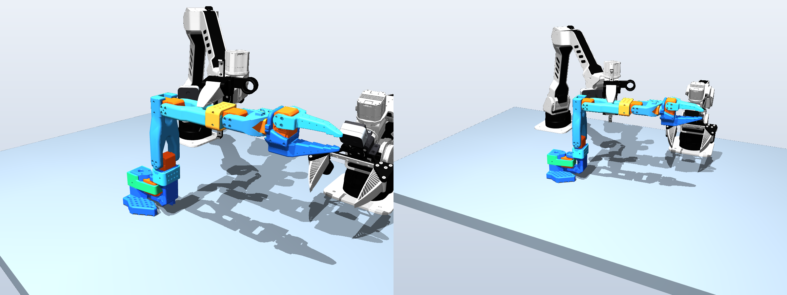

<h1 align="center">SO-101 MuJoCo Assembly: A Bimanual CAD Assembly Scene and Collider Benchmark</h1>

<p align="center">
  <a href="https://huggingface.co/datasets/SeanZheng/so101-mujoco-assembly"></a>
  <a href="https://mujoco.org"></a>
  <a href="docs/ACCEPTANCE_REPORT_v1.1.md"></a>
</p>

<p align="center">
  
</p>

## Table of Contents

- [Overview](#-overview)
- [News](#-news)
- [Download](#-download)
- [Quick Start](#️-quick-start)
  - [Installation](#installation)
  - [Load the Scene](#load-the-scene)
  - [Score Your Own Colliders](#score-your-own-colliders)
- [Performance (v1.1 Baseline)](#-performance-v11-baseline)
  - [Interfaces](#interfaces)
  - [Collider Fidelity](#collider-fidelity)
  - [Speed and Stability](#speed-and-stability)
  - [Known Problems](#known-problems)
- [Scene Contents](#-scene-contents)
- [Repository Layout](#-repository-layout)
- [License](#-license)
- [Citation](#citation)
- [Acknowledgments](#-acknowledgments)

---

## 💫 Overview

Two stock **Panthera-HT** 6-DoF arms assemble an **SO-101** robot arm from its loose CAD parts in **MuJoCo**: grasp,
transport, insert, fasten, release. Only the two parallel grippers and a plain table are used; there are no fixtures.

This release provides:
- **An assembly-ready scene.** Every SO-101 printed part and the M1/M2 servos have CAD-derived convex collision geometry. The scene is checked on 13 insertion interfaces.
- **Assembly interfaces as data.** `interfaces.json` gives the moving part, its predecessors, the full model state at the CAD target, and the withdrawal direction for each of the 13 steps. These are the inputs a code-as-policy planner needs.
- **A collider benchmark.** `benchmark/` scores any collider set for this scene on insertion clearance, pose tolerance, CAD fidelity, grasp-width accuracy, speed and stability. v1.1 is the baseline to beat.

# 🚀 News

- **[2026-11-12]** **v1.1** released: scene, CAD reference meshes, benchmark and the v1.1 baseline scores.

---

# 📦 Download

| Asset | Hugging Face | Size | Description |
| :--- | :--- | :--- | :--- |
| Scene v1.1 | [🤗 `v1.1/so101_mujoco_assembly_v1.1.tar.gz`](https://huggingface.co/datasets/SeanZheng/so101-mujoco-assembly/tree/main/v1.1) | 59.6 MB (239 MB extracted) | `scene.xml` + 15 695 meshes, relative paths, `MANIFEST.json` with sha256 |
| CAD references v1.1 | [🤗 `v1.1/cad_references_v1.1.tar.gz`](https://huggingface.co/datasets/SeanZheng/so101-mujoco-assembly/tree/main/v1.1) | 55.4 MB | CAD reference meshes for 16 parts (body frame, mm); needed by the fidelity and jaw-probe tools |
| Interfaces | [`interfaces.json`](interfaces.json) | 52 KB | 13 assembly interfaces |
| Fidelity locations | [`fidelity_locations.json`](fidelity_locations.json) | 15 KB | per-part missing-material regions (body frame, mm) |

Scene archive sha256: `3be6271e4142bbe60dcd1c53ece6d90c96e83ac1d81e54d07a5c0b80600ce3d9`

---

# 🛠️ Quick Start

## Installation

**Requirements:** Python 3.11; MuJoCo 3.9.0; Linux (the benchmark uses `fork`).

```bash
git clone https://github.com/tomorrow-robotics/so101-mujoco-assembly.git && cd so101-mujoco-assembly
pip install -r requirements.txt
python tools/download.py --version v1.1 --out assets/      # downloads, extracts safely, verifies every sha256
```

## Load the Scene

```bash
python examples/load_scene.py assets/so101_mujoco_assembly_v1.1/scene.xml --cache scene.mjb
```

The first load compiles about 16k convex collision meshes, which takes about 47 s. `--cache` saves the compiled model
(tagged with the MuJoCo version), and later loads take about 1.5 s.

```python
import mujoco
model = mujoco.MjModel.from_xml_path("assets/so101_mujoco_assembly_v1.1/scene.xml")
data = mujoco.MjData(model)
mujoco.mj_step(model, data)
```

## Score Your Own Colliders

Swap the collision geoms of any part, keeping the body names, joints and qpos layout. Then run:

```bash
tar -xzf cad_references_v1.1.tar.gz          # -> references/
bash benchmark/run_all.sh <your_scene.xml> out/ interfaces.json references/
```

Each tool writes one JSON file into `out/`. Compare it with `scores/v1.1/`. The tools can also be run one at a time:

| Tool | Measures |
| :--- | :--- |
| `interface_sweep.py` | swept-solid clearance of each straight-line insertion (pass: > 0.005 mm) |
| `tolerance_envelope.py` | lateral / tilt start-pose error each insertion still tolerates |
| `static_interference.py` | signed distance at each assembled pose, and in the fully assembled state |
| `exposed_gate.py` | collider vs CAD on the exposed surface: within / thinner / fatter than 0.05 mm, missing material |
| `jaw_probe.py` | virtual parallel-jaw width on the collider vs the CAD |
| `model_stats.py` | compile time, model size, memory |
| `step_speed_stability.py` | step time and passive stability from the loose-parts reset |

`interface_sweep.py` reproduces our internal acceptance checker bit-for-bit: the clearance difference is 0.0 mm on all 12 swept interfaces.

---

# 📊 Performance (v1.1 Baseline)

Timings: Intel Xeon Platinum 8481C, one pinned core, single-threaded BLAS. Raw outputs: [`scores/v1.1/`](scores/v1.1).
Full evidence: [`docs/ACCEPTANCE_REPORT_v1.1.md`](docs/ACCEPTANCE_REPORT_v1.1.md).

| Metric | v1.1 |
| :--- | :--- |
| Interfaces passing the swept check (> 0.005 mm) | **12 / 13** (all 8 required pass) |
| Min interface clearance (excluding base_holder) | 0.0128 mm |
| Lateral error tolerated by insertion (min / median) | 0.008 / 0.017 mm |
| Tilt tolerated by insertion (min / median) | 0.018 / 0.047° |
| Max penetration at an assembled interface pose | 0.0097 mm |
| Exposed CAD surface within 0.05 mm (min / median over 12 parts) | 67.2 % / 91.1 % |
| Exposed area fatter than CAD by > 0.05 mm (max over parts) | 0.8 % |
| Max depth of missing CAD material | 2.97 mm |
| Jaw-width probe, \|error\| ≤ 0.1 mm (11 parts, 1099 probes) | 95.2 % |
| Compile from XML | 46.9 s |
| Step time from reset (mean / p50 / p99) | 4.93 / 2.45 / 21.4 ms |
| Passive stability, 2000 steps | 0 warnings, max drift 1.31 mm |

## Interfaces

| Interface | Moving part | Travel (mm) | Clearance (mm) | δ_max (mm) | θ_max (°) | Required |
| :--- | :--- | ---: | ---: | ---: | ---: | :---: |
| base_m1 | motor (M1) | 80 | 0.2836 | 0.281 | 0.797 | ✔ |
| base_holder | holder | 65 | −0.0097 ✗ | 0 | 0 | |
| shoulder_m2 | motor_2 | 80 | 0.0128 | 0.008 | 0.018 | ✔ |
| shoulder_upper | upper_print | 100 | 0.0190 | 0.018 | 0.018 | ✔ |
| upper_m3 | motor3 | 45 | 0.0210 | 0.016 | 0.041 | ✔ |
| m3_forearm | forearm | 65 | 0.0144 | 0.008 | 0.023 | |
| forearm_holder | forearm_holder | 100 | 0.0154 | 0.010 | 0.053 | |
| forearm_m4 | motor4 | 100 | 0.0194 | 0.014 | 0.041 | ✔ |
| wrist_mount | wrist_shell | 40 | 0.1353 | 0.168 | 0.445 | |
| wrist_motor5 | motor5 | 65 | 0.0185 | 0.012 | 0.170 | ✔ |
| wrist_end_frame | frame | 100 | 0.0245 | 0.020 | 0.018 | |
| end_frame_motor6 | housing (M6) | 55 | 0.0342 | 0.027 | 0.100 | ✔ |
| end_frame_jaw | jaw | 35 | 0.0927 | 0.088 | 0.352 | ✔ |

δ_max is the largest lateral start-pose offset that still passes in all 8 directions; θ_max is the largest tilt that still passes in all 4 directions.

## Collider Fidelity

| Part | Within 0.05 mm | Thinner | Fatter | Max missing depth (mm) | Jaw probe ≤ 0.1 mm |
| :--- | ---: | ---: | ---: | ---: | ---: |
| base | 100 % | 0 % | 0 % | 0 | 100 % |
| motor (M1) | 100 % | 0 % | 0 % | 0 | 100 % |
| motor_2 (M2) | 100 % | 0 % | 0 % | 0 | 100 % |
| shoulder_seat | 96.3 % | 3.7 % | 0 % | 2.31 | — |
| shoulder_fork | 94.8 % | 5.2 % | 0 % | 2.43 | 100 % |
| upper_print | 91.1 % | 8.9 % | 0 % | 2.97 | 95.1 % |
| forearm | 91.1 % | 8.8 % | 0 % | 1.73 | 93.7 % |
| jaw | 89.7 % | 10.3 % | 0 % | 2.27 | 100 % |
| frame | 86.1 % | 13.4 % | 0.5 % | 2.45 | 100 % |
| holder | 84.9 % | 15.1 % | 0 % | 2.39 | 95.2 % |
| wrist_shell | 70.8 % | 28.4 % | 0.8 % | 2.11 | 89.6 % |
| forearm_holder | 67.2 % | 32.4 % | 0.3 % | 1.97 | 66.7 % |

## Speed and Stability

| Metric | v1.1 |
| :--- | :--- |
| Geoms (collision) | 16 009 (15 943) |
| Mesh vertices (in collision meshes) | 2.95 M (1.90 M) |
| Compile from XML / load compiled model | 46.9 s / 1.5 s; peak RSS 7.4 GB |
| Step time from reset, 2000 steps (mean / p50 / p99) | 4.93 / 2.45 / 21.4 ms (0.20× real time) |
| Contacts / constraint rows (mean) | 477 / 1439 |
| Warnings / max free-body drift | 0 / 1.31 mm |

## Known Problems

These are what a better collider method should improve.

1. **Tight interfaces.** Ten interfaces have 0.013–0.035 mm of clearance. A rigid straight insertion tolerates only 0.008–0.027 mm of lateral error, about 10× less than the 0.25 mm seating gate.
2. **Holder × Base overlap of 0.0097 mm** at zero-clearance side walls. A quasi-static physical insertion (2 N limit) still seats the holder: peak contact force 0.18 N, final error 0.02 mm.
3. **Shoulder-fork design interference.** Fork × M1-output overlaps 0.91 mm in the assembled state, inherited from the CAD (0.85 mm). The fork's fit is not one of the 13 interfaces.
4. **Thin colliders at mating zones.** Up to 2.97 mm thinner than the CAD, worst on wrist_shell and forearm_holder. The regions are listed in `fidelity_locations.json`; avoid grasping inside them.
5. **Servos M3–M6** still use older colliders, which are not scored here.

---

# 🧩 Scene Contents

- **Robots:** two Panthera-HT arms (`a_*`, `b_*`) from the HighTorque SDK (commit `7c506f8`), with calibrated cameras.
- **SO-101 parts (free bodies):**
  - printed: `base`, `holder`, `shoulder_seat`, `shoulder_fork`, `upper_print`, `forearm`, `forearm_holder`, `wrist_shell`, `frame`, `jaw`;
  - servos: `motor` (M1), `motor_2` (M2), `motor3`–`motor5`, `housing` (M6).
- **Fastening:** inactive weld equality constraints ship with the scene. Activate one only after the part is physically seated within the gates (lateral 0.25 mm, axial 0.5 mm, 1°), using the measured relative pose.
- **Units:** MuJoCo uses SI (m, kg). Meshes, reference meshes and `fidelity_locations.json` are in each part's body frame, in mm (meshes load with `scale="0.001 0.001 0.001"`).

# 📁 Repository Layout

```
benchmark/                       scoring tools + run_all.sh
docs/ACCEPTANCE_REPORT_v1.1.md   full acceptance evidence and known problems
docs/teaser.png                  rendered v1.1 scene
interfaces.json                  13 interfaces: moving part, predecessors, qpos, withdrawal, travel
fidelity_locations.json          per-part fidelity + missing-material regions
scores/v1.1/                     raw benchmark outputs for the v1.1 baseline
tools/download.py                fetch a release from Hugging Face and verify MANIFEST.json
examples/load_scene.py           compile/cache the scene, step it, list collision geoms
```

# 📄 License

To be announced.

# Citation

```bibtex

```

# 🙏 Acknowledgments

- [SO-ARM100 / SO-101](https://github.com/TheRobotStudio/SO-ARM100) by TheRobotStudio, for the CAD models.
- HighTorque, for the Panthera-HT SDK and robot models.
- [MuJoCo](https://github.com/google-deepmind/mujoco).
